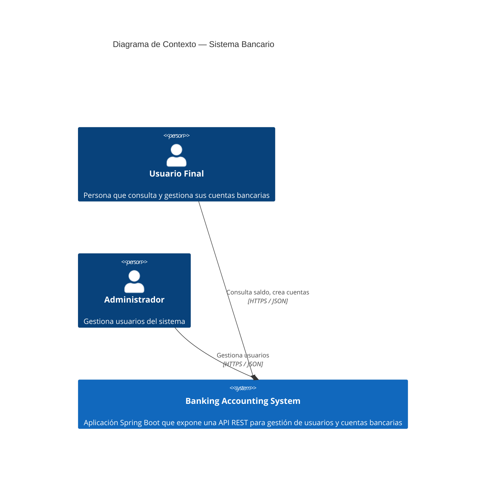
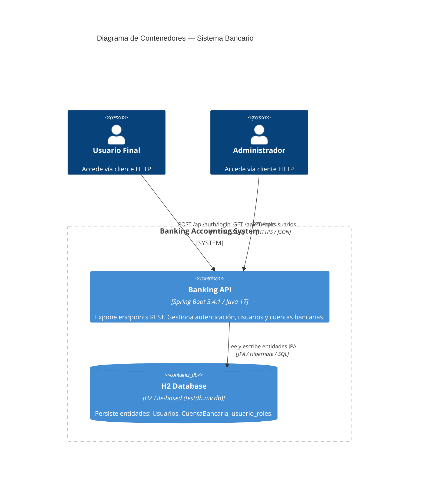
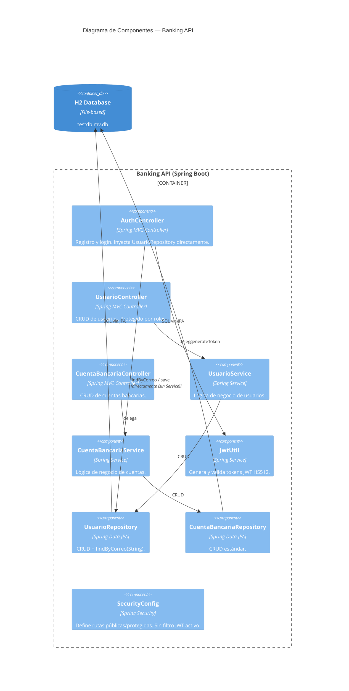

# ADR-001: Arquitectura por Capas (Layered Architecture)

| Campo       | Valor                      |
|-------------|----------------------------|
| **Estado**  | Aceptado                   |
| **Fecha**   | 2026-02-25                 |
| **Autores** | Equipo de Arquitectura     |

---

## Contexto

El sistema bancario necesita una estructura organizada que separe responsabilidades, facilite el mantenimiento y permita escalar cada capa de forma independiente. Se requería un patrón que fuera familiar para equipos Java/Spring y que permitiera añadir nuevas entidades (cuentas, transacciones, usuarios) sin romper el resto del sistema.

## Decisión

Adoptar una **arquitectura por capas estricta** con el flujo:

```
Controller → Service → Repository → H2 Database
```

Cada capa solo puede comunicarse con la capa inmediatamente inferior. Los controladores nunca acceden a repositorios directamente —salvo la excepción documentada en `AuthController` (ver ADR-002).

## Consecuencias

- **Positivas:** Separación de responsabilidades clara; cada capa es independientemente testeable; convención conocida por cualquier desarrollador Spring.
- **Negativas:** Puede generar clases de servicio delgadas (thin services) cuando la lógica de negocio es simple.

---

## C4 Nivel 1 — Diagrama de Contexto del Sistema

Muestra el sistema bancario en relación con sus usuarios y sistemas externos.



---

## C4 Nivel 2 — Diagrama de Contenedores

Muestra los bloques técnicos de alto nivel que componen el sistema.



---

## C4 Nivel 3 — Diagrama de Componentes (Vista General)

Muestra los componentes principales dentro del contenedor API y sus dependencias.


