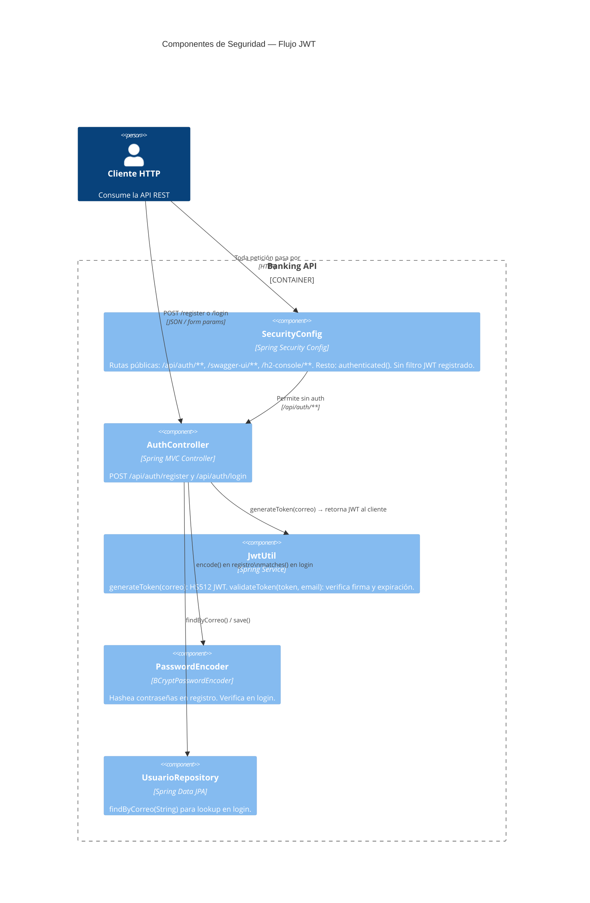
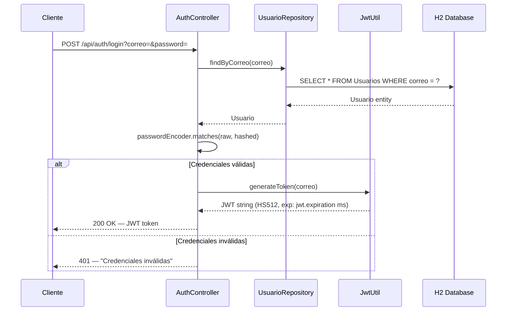

# ADR-002: Autenticación Stateless con JWT

| Campo       | Valor                      |
|-------------|----------------------------|
| **Estado**  | Aceptado                   |
| **Fecha**   | 2026-02-25                 |
| **Autores** | Equipo de Arquitectura     |

---

## Contexto

El sistema necesita autenticación sin estado (stateless) que no requiera sesiones en el servidor. Se optó por JWT (JSON Web Tokens) firmados con HS512, configurables vía `application.properties`.

## Decisión

- `JwtUtil` genera y valida tokens usando `io.jsonwebtoken:jjwt:0.9.1`.
- El token se firma con `jwt.secret` y expira en `jwt.expiration` milisegundos.
- `AuthController` bypasea `UsuarioService` e inyecta `UsuarioRepository` directamente para mantener el flujo de auth autocontenido.
- La contraseña se hashea con BCrypt únicamente en `AuthController.register()`. `UsuarioService.save()` **no** hashea.

## Estado actual (deuda técnica conocida)

| Elemento | Estado |
|----------|--------|
| `JwtUtil.generateToken()` | ✅ Funcional |
| `JwtUtil.validateToken()` | ✅ Funcional |
| Filtro JWT en `SecurityFilterChain` | ❌ No implementado |
| `@EnableMethodSecurity` en `SecurityConfig` | ❌ Ausente — `@PreAuthorize` no se aplica en runtime |

## Consecuencias

- Los endpoints marcados como "autenticados" en `SecurityConfig` no validan el JWT porque no hay filtro registrado.
- `@PreAuthorize("hasAuthority('ADMIN')")` en `UsuarioController` no tiene efecto hasta que se añada `@EnableMethodSecurity`.

---

## C4 Nivel 3 — Componentes de Seguridad

Flujo de autenticación y autorización dentro del sistema.

---

## Flujo de Autenticación (Secuencia)

