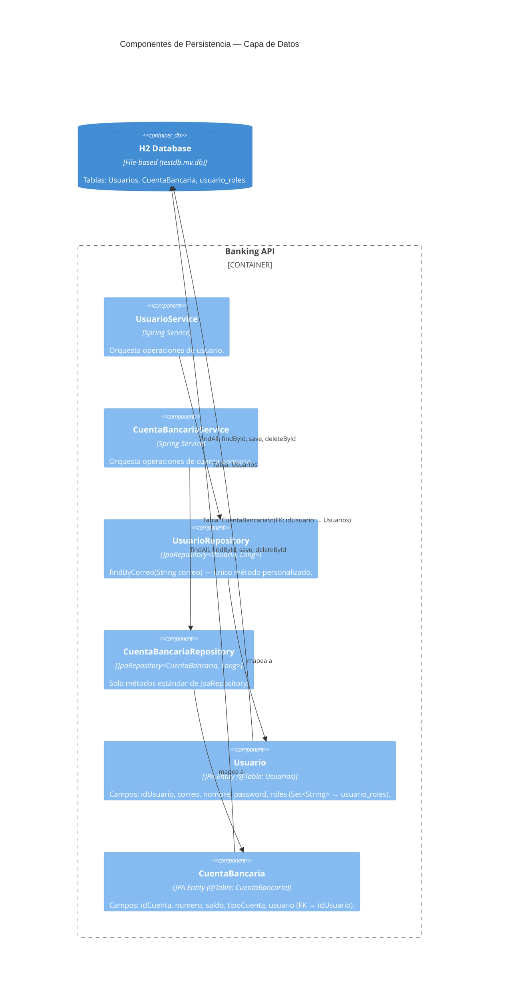
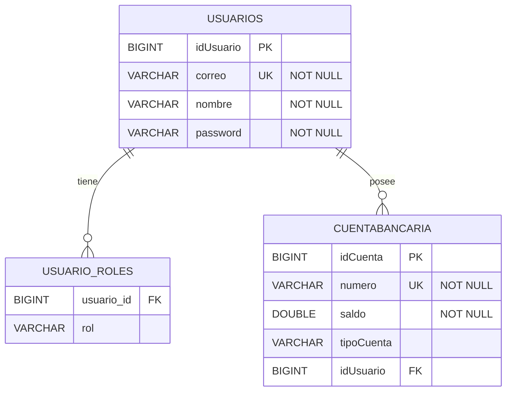

# ADR-003: Base de Datos H2 File-based

| Campo       | Valor                      |
|-------------|----------------------------|
| **Estado**  | Aceptado                   |
| **Fecha**   | 2026-02-25                 |
| **Autores** | Equipo de Arquitectura     |

---

## Contexto

Para este proof-of-concept se requiere una base de datos embebida que no necesite instalación externa, sea accesible mediante consola web y persista los datos entre reinicios de la aplicación durante el desarrollo.

## Decisión

Usar **H2 en modo file-based** (`jdbc:h2:file:./testdb`) en lugar de in-memory. Esto garantiza que los datos sobrevivan reinicios del servidor mientras se prueba localmente. El esquema es gestionado automáticamente por Hibernate (`ddl-auto=update`).

## Consecuencias

- El archivo `testdb.mv.db` vive en la raíz del proyecto y está en `.gitignore`.
- La H2 Console está habilitada en `/h2-console` (solo útil en desarrollo).
- Si se migra a PostgreSQL/MySQL, solo se necesita cambiar `spring.datasource.*` y el driver en `build.gradle`.

---

## C4 Nivel 3 — Componentes de Persistencia

Muestra cómo las entidades del dominio se mapean a tablas en H2.

---

## Modelo de Datos

