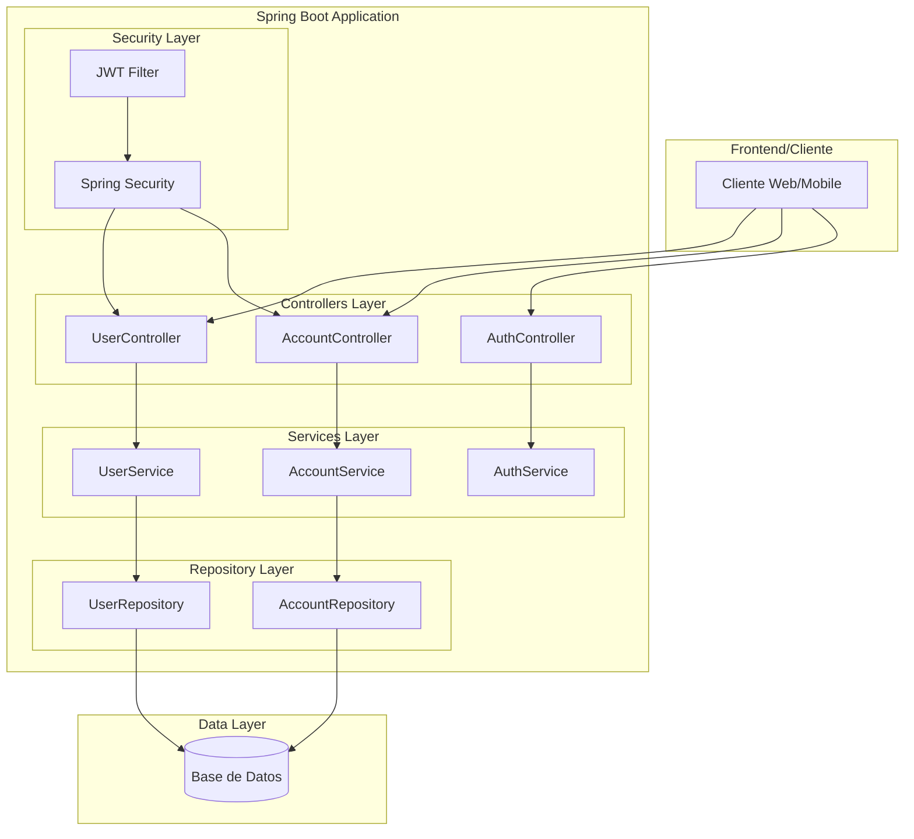
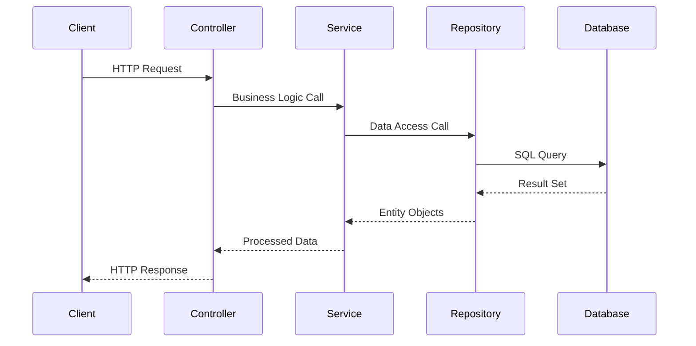

# Spring Data PCO (Prueba de Concepto)

Sistema bancario desarrollado como prueba de concepto utilizando Spring Data y arquitectura por capas.

## 🏗️ Arquitectura General



📋 **[Ver Diagrama Detallado de Componentes C4](docs/architecture/components.md)** - Análisis detallado de cada componente y sus interacciones

## 📐 Architecture Decision Records (ADR)

Las decisiones de arquitectura están documentadas con diagramas C4 en el directorio `.docs/adr/`:

| ADR | Título | Diagramas C4 |
|-----|--------|-------------|
| [ADR-001](.docs/adr/ADR-001-arquitectura-por-capas.md) | Arquitectura por Capas | Contexto (L1), Contenedores (L2), Componentes (L3) |
| [ADR-002](.docs/adr/ADR-002-autenticacion-jwt.md) | Autenticación Stateless con JWT | Componentes de Seguridad (L3), Secuencia |
| [ADR-003](.docs/adr/ADR-003-base-de-datos-h2.md) | Base de Datos H2 File-based | Componentes de Persistencia (L3), ER |

📂 **[Ver índice completo de ADRs](.docs/README.md)**

## 📋 Descripción de Capas

### Controllers (Capa de Presentación)
- **Responsabilidad**: Manejo de peticiones HTTP, validación de entrada y formateo de respuestas
- **Características**: RESTful APIs, manejo de excepciones, validaciones
- **Tecnologías**: Spring MVC, Spring Validation

### Services (Capa de Negocio)
- **Responsabilidad**: Lógica de negocio, orquestación de operaciones, validaciones de negocio
- **Características**: Transacciones, reglas de negocio, coordinación entre repositorios
- **Tecnologías**: Spring Service, Spring Transaction

### Repository (Capa de Acceso a Datos)
- **Responsabilidad**: Abstracción del acceso a datos, operaciones CRUD
- **Características**: Queries personalizadas, paginación, ordenamiento
- **Tecnologías**: Spring Data JPA, Hibernate

### Security (Capa de Seguridad)
- **Responsabilidad**: Autenticación, autorización, protección de endpoints
- **Características**: JWT tokens, filtros de seguridad, roles y permisos
- **Tecnologías**: Spring Security, JWT

## 🗂️ Entidades Principales

### [CuentaBancaria.java](src/main/java/com/banking/accounting/entities/CuentaBancaria.java)
Entidad que representa las cuentas bancarias del sistema

### [Usuario.java](src/main/java/com/banking/accounting/entities/Usuario.java)
Entidad que representa los usuarios del sistema bancario

## 🛠️ Stack Tecnológico

| Categoría | Tecnología | Versión | Descripción |
|-----------|------------|---------|-------------|
| **Framework Principal** | Spring Boot | 3.x | Framework base para desarrollo de aplicaciones |
| **Persistencia** | Spring Data JPA | - | Abstracción para acceso a datos |
| **ORM** | Hibernate | - | Mapeo objeto-relacional |
| **Seguridad** | Spring Security | - | Framework de seguridad |
| **Autenticación** | JWT | - | Tokens para autenticación stateless |
| **Base de Datos** | H2/MySQL/PostgreSQL | - | Sistema de gestión de base de datos |
| **Build Tool** | Gradle | - | Herramienta de construcción y gestión de dependencias |
| **Testing** | JUnit 5 | - | Framework de pruebas unitarias |
| **Validación** | Bean Validation | - | Validación de datos |

## 🚀 Características del Proyecto

- ✅ **Arquitectura por Capas**: Separación clara de responsabilidades
- ✅ **RESTful APIs**: Endpoints bien definidos siguiendo convenciones REST
- ✅ **Seguridad JWT**: Autenticación sin estado usando tokens
- ✅ **Spring Data JPA**: Acceso simplificado a datos con repositorios
- ✅ **Validaciones**: Validación de datos tanto en entrada como en negocio
- ✅ **Manejo de Excepciones**: Gestión centralizada de errores
- ✅ **Configuración Externalizada**: Configuración flexible por ambiente

## 📁 Estructura del Proyecto

```
src/main/java/com/banking/accounting/
├── controllers/     # Controladores REST
├── services/        # Lógica de negocio
├── repositories/    # Acceso a datos
├── entities/        # Entidades JPA
├── dto/            # Objetos de transferencia de datos
├── config/         # Configuraciones
└── security/       # Configuración de seguridad
```

## 🔧 Configuración y Ejecución

### Prerrequisitos
- Java 17+
- Gradle 7+

### Ejecución Local
```bash
# Compilar el proyecto
./gradlew build

# Ejecutar la aplicación
./gradlew bootRun
```

## 📊 Flujo de Datos



## 🎯 Próximos Pasos

- [ ] Implementar pruebas de integración
- [ ] Agregar documentación con Swagger/OpenAPI
- [ ] Implementar métricas y monitoreo
- [ ] Configurar perfiles de ambiente
- [ ] Agregar cache con Redis
- [ ] Implementar logging estructurado