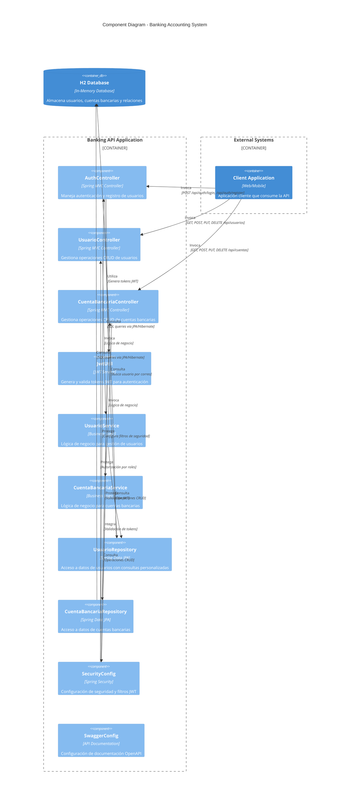

# Diagrama C4 de Componentes - Sistema Bancario

Este documento presenta el diagrama C4 de componentes del sistema bancario desarrollado con Spring Boot, mostrando los principales módulos del backend y sus interacciones.

## 🏗️ Diagrama de Componentes

## 📱 Descripción de Componentes

### **Controllers (Capa de Presentación)**
Los controladores manejan las peticiones HTTP y coordinan las respuestas:

- **AuthController**: 
  - Responsabilidad: Autenticación y registro de usuarios
  - Endpoints: `/api/auth/login`, `/api/auth/register`
  - Tecnología: Spring MVC

- **UsuarioController**: 
  - Responsabilidad: Gestión CRUD de usuarios
  - Endpoints: `/api/usuarios/*`
  - Funciones: Crear, leer, actualizar, eliminar usuarios

- **CuentaBancariaController**: 
  - Responsabilidad: Gestión CRUD de cuentas bancarias
  - Endpoints: `/api/cuentas/*`
  - Funciones: Operaciones bancarias básicas

### **🧠 Services (Capa de Negocio)**
Los servicios implementan la lógica de negocio y orquestan las operaciones:

- **UsuarioService**: 
  - Lógica de negocio para usuarios
  - Validaciones de datos
  - Transformaciones y reglas de negocio

- **CuentaBancariaService**: 
  - Reglas de negocio para cuentas
  - Validaciones de saldo y transacciones
  - Coordinación de operaciones complejas

- **JwtUtil**: 
  - Generación y validación de tokens JWT
  - Manejo de claims y expiración
  - Integración con Spring Security

### **🗄️ Repositories (Capa de Acceso a Datos)**
Los repositorios proporcionan abstracción para el acceso a datos:

- **UsuarioRepository**: 
  - Extiende `JpaRepository<Usuario, Long>`
  - Consulta personalizada: `findByCorreo(String correo)`
  - Operaciones CRUD estándar

- **CuentaBancariaRepository**: 
  - Extiende `JpaRepository<CuentaBancaria, Long>`
  - Operaciones CRUD para cuentas bancarias
  - Consultas automáticas generadas por Spring Data

### **🔐 Security & Configuration**
Componentes transversales de configuración y seguridad:

- **SecurityConfig**: 
  - Configuración de Spring Security
  - Definición de rutas públicas y protegidas
  - Filtros JWT y políticas de autorización

- **SwaggerConfig**: 
  - Configuración de documentación OpenAPI
  - Definición de esquemas de API
  - Interfaz de pruebas interactiva

### **🗃️ Base de Datos**
- **H2 Database**: 
  - Base de datos en memoria para desarrollo
  - Configuración simple y rápida
  - Ideal para pruebas y desarrollo local

## 🔄 Flujo Típico de una Operación

1. **Cliente** → Envía petición HTTP al **Controller**
2. **Controller** → Valida entrada y delega al **Service**
3. **Service** → Ejecuta lógica de negocio y consulta **Repository**
4. **Repository** → Ejecuta operaciones en la **Base de Datos**
5. **Base de Datos** → Retorna datos al **Repository**
6. **Repository** → Convierte a entidades y retorna al **Service**
7. **Service** → Procesa datos y retorna al **Controller**
8. **Controller** → Formatea respuesta HTTP y retorna al **Cliente**

## 🔐 Flujo de Autenticación

1. **Cliente** → POST `/api/auth/login` con credenciales
2. **AuthController** → Valida credenciales via **UsuarioRepository**
3. **JwtUtil** → Genera token JWT con claims del usuario
4. **Cliente** → Recibe token y lo incluye en headers subsecuentes
5. **SecurityConfig** → Valida token en cada petición protegida
6. **Controllers** → Procesan peticiones autenticadas

## 🎯 Beneficios de esta Arquitectura

- **Separación de Responsabilidades**: Cada capa tiene una función específica
- **Testabilidad**: Componentes independientes fáciles de probar
- **Mantenibilidad**: Cambios aislados en cada capa
- **Escalabilidad**: Estructura clara para agregar nuevas funcionalidades
- **Reutilización**: Servicios y repositorios reutilizables